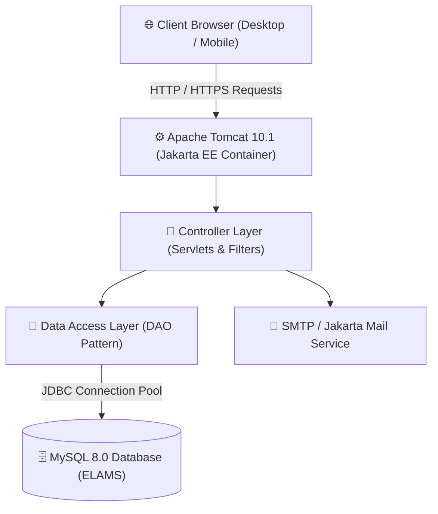
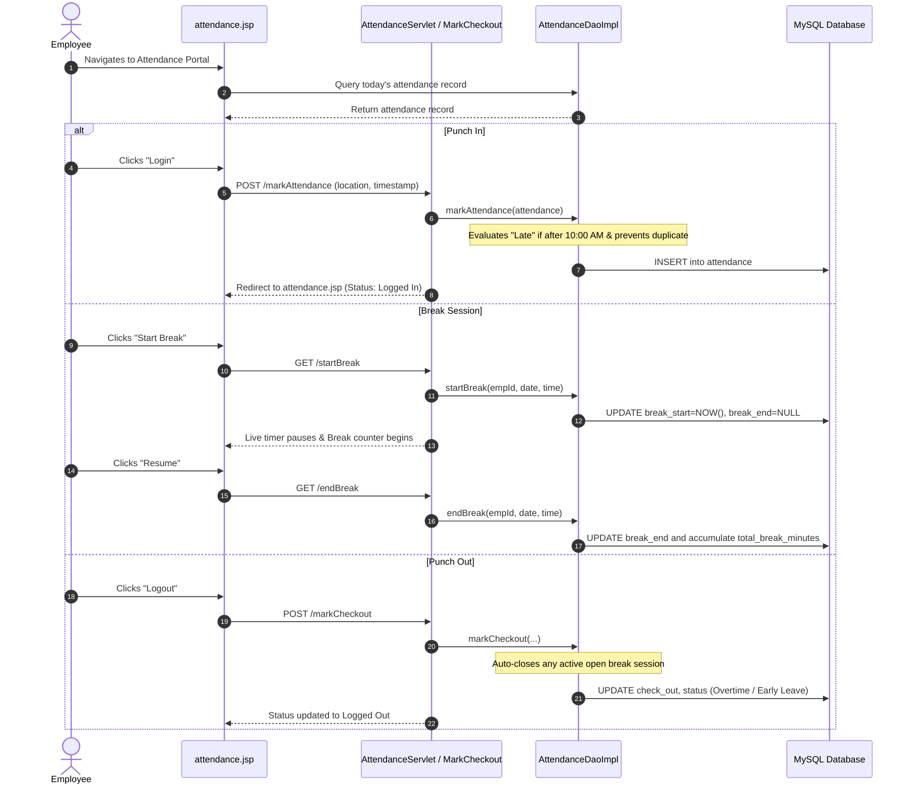
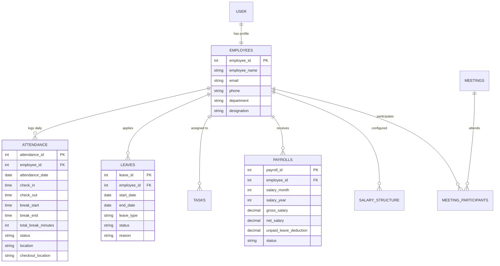

# 🏢 Employee Leave & Attendance Management System (ELAMS)

[](https://www.oracle.com/java/)
[-FF7800?style=for-the-badge&logo=eclipseide&logoColor=white)](https://jakarta.ee/)
[](https://tomcat.apache.org/)
[](https://www.mysql.com/)
[](LICENSE)

> Developed by **[@Rajesh7214](https://github.com/Rajesh7214)**

---

## 📌 Project Overview
**ELAMS** is an enterprise-grade Human Resources and Operations Management web application built with **Jakarta EE 10**, **Apache Tomcat 10.1**, and **MySQL 8.0+**. It delivers an automated, end-to-end workforce solution covering real-time attendance punching, break management, multi-tier leave approval workflows, dynamic payroll computation with automated Loss of Pay (LOP) deductions, task tracking, meeting room reservations, and security audit logs.

---

## ✨ Core Features & Modules

### ⏱️ 1. Attendance & Duty Session Engine
* **One-Click Punch In / Punch Out**: Instant timestamp recording with auto-captured enterprise location / geolocation tags.
* **Smart Late Arrival Detection**: Check-ins after 10:00 AM automatically flagged as `"Late"`.
* **Break Management**: Dynamic `startBreak` and `endBreak` actions with live elapsed minute tracking.
* **Auto-Close Break on Logout**: Automatically finalizes active breaks if an employee logs out without resuming.
* **Shift Classification**: Automatically evaluates shifts as `"Early Leave"` (< 6:00 PM), `"Overtime"` (> 6:00 PM), or `"Present"`.
* **Live Active Work Timer**: Real-time JavaScript timer in `attendance.jsp` that accurately pauses during break sessions.
* **Duplicate Check-in Guard**: Prevents accidental double check-ins on the same calendar date.

### 🌴 2. Leave Management & Approval Engine
* **Application Form**: Casual, Sick, and Unpaid (Loss of Pay - LOP) leave applications with dates and remarks.
* **Multi-Tier Review**: Interactive approval/rejection console for HR and Managers.
* **Dynamic Quota Deduction**: Automatic reduction of remaining leave balances upon approval.
* **Direct Payroll Hook**: Unpaid leave days (LOP) are automatically passed to the salary calculation engine.

### 💰 3. Payroll & Statutory Deduction Engine
* **Configurable Salary Structure**: Custom Basic Pay, HRA, Transport, Medical, and Other Allowances per employee.
* **Statutory Deductions**: Automated computation of Provident Fund (PF) and Professional Tax.
* **Automated Loss of Pay (LOP) Math**:
  $$\text{Per Day Salary} = \frac{\text{Gross Salary}}{\text{Working Days (26)}}$$
  $$\text{LOP Deduction} = \text{Per Day Salary} \times \text{Approved Unpaid Leave Days}$$
  $$\text{Net Salary} = \text{Gross Salary} - (\text{PF} + \text{PT} + \text{LOP} + \text{Other Deductions})$$
* **Digital Payslips**: Clean, downloadable employee monthly payslips with full earnings and deductions itemization.

### 👥 4. Workforce & Employee Directory
* Complete employee record management with department, designation, and contact details.
* Role-Based Access Control (RBAC) ensuring data boundaries across **Admin**, **HR**, **Manager**, and **Employee**.
* Self-service employee profile update console.

### 📋 5. Task Allocation & Tracking
* Manager task creation with priority levels (`Low`, `Medium`, `High`) and strict deadlines.
* Interactive 3-stage lifecycle: `Pending` → `In Progress` → `Completed`.
* Real-time task metrics on employee dashboards.

### 📅 6. Meeting & Room Booking Portal
* Conference room availability verification, scheduling, and participant invitations.
* In-meeting attendance logging, shared meeting minutes (MOM), and attachment uploads.

### 🔒 7. Security & Audit Trail
* **BCrypt Hashing**: Strong cryptographic password hashing for all user accounts.
* **Session Guards**: Automated redirect to `login.jsp` if an unauthenticated session is detected.
* **Audit Trail**: Detailed logging of login IP addresses, browser agents, timestamps, and authentication outcomes.

---

## 🏛️ System Architecture



---

## 👥 Role-Based Access Matrix

| Feature | Admin | HR Manager | Team Manager | Employee |
| :--- | :---: | :---: | :---: | :---: |
| **Punch In / Out & Breaks** | ✅ | ✅ | ✅ | ✅ |
| **Personal Attendance History** | ✅ | ✅ | ✅ | ✅ |
| **All Employees Attendance** | ✅ | ✅ | ✅ (Team) | ❌ |
| **Apply for Leave** | ✅ | ✅ | ✅ | ✅ |
| **Approve / Reject Leaves** | ✅ | ✅ | ✅ | ❌ |
| **Employee Directory Management** | ✅ | ✅ | ❌ | ❌ |
| **Task Assignment** | ✅ | ❌ | ✅ | ✅ (Status Update) |
| **Schedule Meetings & Rooms** | ✅ | ✅ | ✅ | ❌ |
| **Process Payroll & LOP** | ✅ | ✅ | ❌ | ❌ |
| **View Personal Payslips** | ✅ | ✅ | ✅ | ✅ |
| **Audit Logs & Settings** | ✅ | ❌ | ❌ | ❌ |

---

## 🔄 Attendance & Duty Session Flow



---

## 🗄️ Database Schema (Core Tables)



---

## 🚀 Quick Start Guide

### Prerequisites
* **Java Development Kit**: JDK 17, 21, or 26
* **Servlet Container**: Apache Tomcat 10.1+
* **Database**: MySQL Server 8.0+
* **IDE**: Eclipse IDE for Enterprise Java (or VS Code / IntelliJ)

### 1. Database Setup
```sql
CREATE DATABASE ELAMS;
USE ELAMS;
SOURCE schema.sql;
```

### 2. Configure Database Credentials
Edit [`src/main/java/com/rajesh/elams/util/DbUtil.java`](src/main/java/com/rajesh/elams/util/DbUtil.java):
```java
private static String url = "jdbc:mysql://localhost:3306/ELAMS";
private static String user = "root";
private static String pwd  = "your_mysql_password";
```

### 3. Deploy & Run on Tomcat
1. Import the project into Eclipse as an **Existing Maven/Dynamic Web Project**.
2. Right-click the project root → **Run As** → **Run on Server** (`Apache Tomcat v10.1`).
3. Open your browser and navigate to:
   ```text
   http://localhost:8080/Employee_Leave_And_Attendance_Management/login.jsp
   ```

### 🔑 Default Credentials for Testing

| Role | Email | Password |
| :--- | :--- | :--- |
| **Employee** | `rajesh@elams.com` | `emp123` |
| **Admin** | `admin@elams.com` | `admin123` |
| **Manager** | `manager@elams.com` | `manager123` |
| **HR** | `hr@elams.com` | `hr123` |

---

## 🛠️ Tech Stack & Dependencies

* **Language**: Java 17+ (Jakarta EE 10)
* **Web Tier**: Jakarta Servlet 6.0, JSP 3.1, JSTL 3.0
* **Server**: Apache Tomcat 10.1.x
* **Database**: MySQL 8.0 with `mysql-connector-j-9.7.0.jar`
* **Security**: `jBCrypt-0.4.jar`
* **Mailing**: `angus-mail-2.1.0-M1.jar`
* **Styling & UI**: Custom Glassmorphism CSS, FontAwesome 6.6, Google Plus Jakarta Sans & JetBrains Mono

---

## 👤 Author

* **Rajesh Kumar** — [@Rajesh7214](https://github.com/Rajesh7214)
* **Repository**: [Rajesh7214/Employee_Leave_And_Attendance_Management](https://github.com/Rajesh7214/Employee_Leave_And_Attendance_Management)
