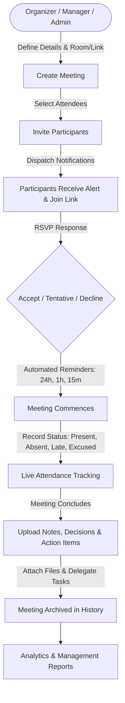
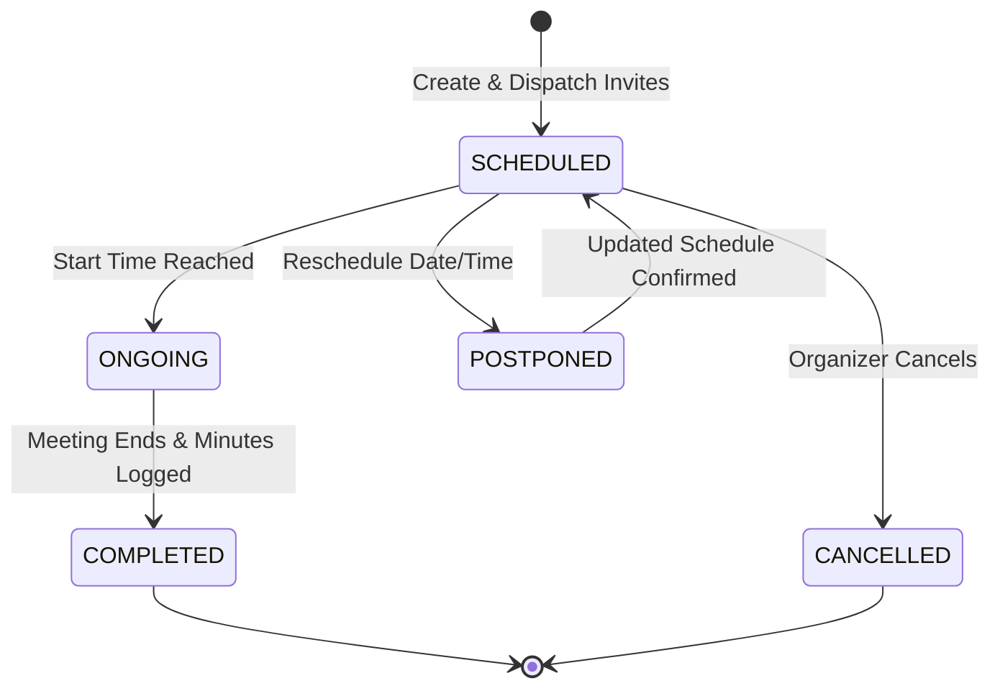

# SmartOffice – Office Automation & Workforce Management System
## Meeting Management Module — Technical & Functional Documentation

**Module Name:** Meeting Management Module  
**Document Version:** 1.0  
**Status:** Approved & Implemented  
**Author:** SmartOffice Engineering & Development Team  

---

## 1. Module Overview
The **Meeting Management Module** empowers employees, managers, human resources (HR), and administrators to schedule, organize, attend, and monitor meetings seamlessly within the SmartOffice platform.

By replacing manual scheduling and ad-hoc communication with an automated, end-to-end digital workflow, the module delivers:
- Multi-mode meeting organization (Online, In-Person Offline, Hybrid).
- Real-time conflicts detection and smart room management.
- Multi-channel automated reminders (Dashboard, Email, SMS).
- Participant invitation responses and live attendance tracking.
- Post-meeting minutes recording (agendas, key decisions, action items, and task delegations).
- Comprehensive audit trails and analytical reporting.

---

## 2. Core Objectives
- **Frictionless Scheduling:** Rapid meeting configuration with participant multi-select, room allocation, and video conference link integration.
- **Conflict Prevention:** Automatic prevention of overlapping meetings for rooms and organizers.
- **Automated Communication:** Immediate dispatch of invitations, updates, reminders, and cancellations.
- **Attendance & Engagement Tracking:** Accurate recording of attendee status (`Present`, `Absent`, `Late`, `Excused`).
- **Knowledge Retention:** Centralized repository for meeting minutes, summaries, decisions, and downloadable attachments.
- **Actionable Reporting:** Detailed department-wise, employee-wise, duration, and attendance analytics.

---

## 3. Architecture & Meeting Lifecycle Workflow

---

## 4. Feature Breakdown

### 4.1 Meeting Configuration & Creation
Authorized users (Admins, HRs, Managers) can create meetings with:
- **Core Info:** Title, Description, and Structured Agenda.
- **Date & Timing:** Meeting Date, Start Time, End Time, and Duration Calculation.
- **Classification:** Meeting Type, Priority (`LOW`, `MEDIUM`, `HIGH`, `URGENT`), and Meeting Mode.
- **Location / Link:** Physical Meeting Room selection or Online Video Conference URL (Google Meet, Zoom, Teams).
- **Participants:** Multi-select employee list with instant department grouping.
- **Attachments:** Agendas, slide decks, PDFs, and briefing documents.

### 4.2 Meeting Types & Modes
| Category | Supported Types / Modes | Description |
| :--- | :--- | :--- |
| **Meeting Types** | `Team Meeting`, `Client Meeting`, `Department Meeting`, `HR Meeting`, `Project Discussion`, `Sprint Planning`, `Daily Standup`, `Review Meeting`, `Interview`, `Training Session` | Covers all standard corporate, agile, and administrative scenarios. |
| **Meeting Modes** | `Online`, `Offline`, `Hybrid` | Online requires meeting URL; Offline requires physical room; Hybrid supports both. |

### 4.3 Participant Invitations & RSVPs
- **Invitee Scope:** Employees, Managers, HR, Admins, and External Guests.
- **RSVP States:** `PENDING`, `ACCEPTED`, `TENTATIVE`, `DECLINED`.
- **Invitation Package:** Date, Time, Duration, Agenda, Room, and 1-click Video Join Link.

### 4.4 Calendar & Schedule Views
- **Daily View:** Minute-by-minute timeline for the current working day.
- **Weekly View:** Workweek overview highlighting busy/free slots.
- **Monthly View:** Calendar grid with color-coded priority and type badges.

### 4.5 Multi-Channel Meeting Reminders
- **Trigger Intervals:** 1 Day Prior &bull; 1 Hour Prior &bull; 15 Minutes Prior.
- **Delivery Channels:**
  1. In-App Notification Dropdown & Toast alert.
  2. HTML Email Notice with calendar attachment.
  3. Direct Mobile SMS alert for urgent meetings.

### 4.6 Attendance Tracking
- **States:** `Present`, `Absent`, `Late`, `Excused`.
- Live roll-call capability for organizers and managers with immediate attendance percentage generation.

### 4.7 Post-Meeting Notes, Action Items & Attachments
- **Discussion Summary:** Executive summary of items discussed.
- **Key Decisions:** Binding decisions agreed upon during the session.
- **Action Items & Delegations:** Directly convert notes into trackable SmartOffice tasks.

### 4.8 Search, Filter & History Archive
- **Search Criteria:** Title, Organizer Name, Attendee Name, Department.
- **Filters:** Date Range, Status (`SCHEDULED`, `ONGOING`, `COMPLETED`, `CANCELLED`, `POSTPONED`), Meeting Type, Priority.

---

## 5. Actors & Role-Based Access Control (RBAC)

| Actor | Permissions & Capabilities |
| :--- | :--- |
| **Admin** | &bull; Full CRUD on all organization meetings. &bull; Manage meeting rooms and physical capacity. &bull; Generate organization-wide attendance and utilization reports. &bull; Override scheduling conflicts. |
| **HR** | &bull; Schedule HR syncs, orientation, and interview sessions. &bull; View department attendance and meeting reports. &bull; Broadcast meeting notices to specific departments or company-wide. |
| **Manager** | &bull; Schedule team meetings, sprint reviews, and 1-on-1s. &bull; Invite team members and track RSVPs. &bull; Conduct roll-call attendance and record meeting minutes. &bull; Delegate action items as tasks. |
| **Employee** | &bull; Access personal meeting calendar and upcoming invites. &bull; Submit RSVP (`Accept`, `Decline`, `Tentative`). &bull; 1-click Join video conference. &bull; Access historical meeting notes and downloaded resources. |

---

## 6. Functional & Non-Functional Requirements

### 6.1 Functional Requirements (FR)
- **FR-1:** System shall enable authorized users to create, schedule, and configure meetings with full metadata.
- **FR-2:** System shall allow organizers and admins to update meeting details, timing, rooms, and agendas.
- **FR-3:** System shall automatically generate and dispatch participant invitations upon meeting creation.
- **FR-4:** System shall execute automated background reminders at configured intervals (24h, 1h, 15m).
- **FR-5:** System shall maintain individual and aggregate attendance records for every meeting session.
- **FR-6:** System shall allow organizers to upload and distribute meeting minutes and document attachments.
- **FR-7:** System shall produce downloadable and printable meeting reports (CSV, PDF, Excel).
- **FR-8:** System shall persist all completed and cancelled meetings in a queryable historical archive.

### 6.2 Non-Functional Requirements (NFR)
- **Performance:** Meeting scheduling and conflict checks complete in $<2$ seconds; notifications dispatched in $<30$ seconds.
- **Security:** Strict session authentication, Role-Based Access Control (RBAC), and sanitization of input text and attachments.
- **Reliability:** 99.9% availability with transactional consistency across MySQL meeting and participant records.
- **Scalability:** Designed to handle tens of thousands of concurrent meetings across multi-department enterprise setups.

---

## 7. Database Schema & Data Dictionary

### Table: `meetings`
| Column Name | Data Type | Constraints | Description |
| :--- | :--- | :--- | :--- |
| `meeting_id` | `INT` | `PRIMARY KEY`, `AUTO_INCREMENT` | Unique meeting identifier. |
| `title` | `VARCHAR(100)` | `NOT NULL` | Brief meeting title/subject. |
| `description` | `TEXT` | `NULL` | Detailed meeting overview. |
| `agenda` | `TEXT` | `NULL` | Bulleted discussion points. |
| `organizer_id` | `INT` | `NOT NULL`, `FK -> employees` | Employee ID of the meeting organizer. |
| `meeting_date` | `DATE` | `NOT NULL` | Scheduled meeting date. |
| `start_time` | `TIME` | `NOT NULL` | Meeting start time. |
| `end_time` | `TIME` | `NOT NULL` | Meeting conclusion time. |
| `meeting_type` | `VARCHAR(50)` | `NOT NULL` | Type (e.g., `Team Meeting`, `Client Meeting`, `Interview`). |
| `meeting_mode` | `VARCHAR(30)` | `NOT NULL` | Mode: `Online`, `Offline`, `Hybrid`. |
| `room` | `VARCHAR(50)` | `NULL` | Physical room or conference hall name. |
| `meeting_link` | `VARCHAR(255)`| `NULL` | Video conference URL (Zoom/Meet/Teams). |
| `priority` | `VARCHAR(20)` | `DEFAULT 'MEDIUM'` | Priority: `LOW`, `MEDIUM`, `HIGH`, `URGENT`. |
| `status` | `VARCHAR(30)` | `DEFAULT 'SCHEDULED'` | `SCHEDULED`, `ONGOING`, `COMPLETED`, `CANCELLED`, `POSTPONED`. |
| `created_at` | `TIMESTAMP` | `DEFAULT CURRENT_TIMESTAMP` | Timestamp of creation. |

### Table: `meeting_participants`
| Column Name | Data Type | Constraints | Description |
| :--- | :--- | :--- | :--- |
| `participant_id` | `INT` | `PRIMARY KEY`, `AUTO_INCREMENT` | Unique participant record ID. |
| `meeting_id` | `INT` | `NOT NULL`, `FK -> meetings` | Associated meeting reference. |
| `employee_id` | `INT` | `NOT NULL`, `FK -> employees` | Target attendee employee reference. |
| `invitation_status` | `VARCHAR(20)` | `DEFAULT 'PENDING'` | `PENDING`, `ACCEPTED`, `TENTATIVE`, `DECLINED`. |
| `attendance` | `VARCHAR(20)` | `DEFAULT 'Pending'` | `Present`, `Absent`, `Late`, `Excused`. |

### Table: `meeting_notes`
| Column Name | Data Type | Constraints | Description |
| :--- | :--- | :--- | :--- |
| `note_id` | `INT` | `PRIMARY KEY`, `AUTO_INCREMENT` | Unique note ID. |
| `meeting_id` | `INT` | `NOT NULL`, `FK -> meetings` | Associated meeting reference. |
| `summary` | `TEXT` | `NOT NULL` | Comprehensive minutes and summary. |
| `action_items` | `TEXT` | `NULL` | Follow-up action items and task notes. |
| `uploaded_by` | `INT` | `NOT NULL`, `FK -> employees` | User who uploaded minutes. |
| `uploaded_at` | `TIMESTAMP` | `DEFAULT CURRENT_TIMESTAMP` | Time of upload. |

### Table: `meeting_rooms`
| Column Name | Data Type | Constraints | Description |
| :--- | :--- | :--- | :--- |
| `room_id` | `INT` | `PRIMARY KEY`, `AUTO_INCREMENT` | Unique room record ID. |
| `room_name` | `VARCHAR(50)` | `NOT NULL`, `UNIQUE` | e.g. "Conference Room A (Alpha)". |
| `capacity` | `INT` | `NOT NULL` | Maximum seating capacity. |
| `location` | `VARCHAR(100)`| `NULL` | Floor or building wing. |
| `facilities` | `VARCHAR(255)`| `NULL` | Projector, Whiteboard, Video Cam, etc. |
| `is_active` | `BOOLEAN` | `DEFAULT TRUE` | Availability flag. |

---

## 8. Validation Rules & Business Constraints
1. **Title Required:** Meeting title must be between 3 and 100 characters.
2. **Chronological Validity:** `start_time` must precede `end_time`; `meeting_date` cannot be in the past for new meetings.
3. **Minimum Duration:** Meeting duration must be at least 15 minutes.
4. **Mandatory Organizer:** Every meeting must have a valid organizer employee ID.
5. **Mode Consistency:**
   - Online meetings mandate a valid URL in `meeting_link`.
   - Offline meetings mandate a selected room in `room`.
   - Hybrid meetings require both.
6. **No Duplicate Attendees:** The same employee cannot be invited multiple times to the same meeting ID.
7. **Room Conflict Guard:** Two overlapping meetings cannot reserve the same physical `room` at the same date and overlapping time interval.

---

## 9. Meeting Status State Machine

---

## 10. Reporting & Analytics Matrix

The system provides dedicated operational and executive reporting:
1. **Daily / Weekly / Monthly Meeting Agenda:** Real-time chronological listings of meetings by timeframe.
2. **Employee-Wise Participation Report:** Total invitations received, acceptance rate %, and attendance records.
3. **Department-Wise Meeting Load:** Distribution of meetings across Engineering, HR, Sales, Operations, and Management.
4. **Attendance Reliability Analysis:** Percentages of `Present` vs `Late` vs `Absent` attendees.
5. **Room Utilization Analytics:** Frequency and peak occupancy analysis of physical conference facilities.
6. **Export Engines:** Direct export to CSV and formatted print-friendly views.

---

## 11. Key Advantages & Business Impact
- **Eliminates Scheduling Friction:** Cuts meeting organization time from 15+ minutes to under 30 seconds.
- **Prevents Room Collisions:** Real-time room availability verification prevents double booking.
- **Ensures Accountability:** Formal RSVP responses and attendance tracking maintain transparency.
- **Centralizes Organizational Knowledge:** Meeting minutes, attachments, and decisions remain queryable indefinitely.
- **Boosts Team Productivity:** Action items directly bridge into assignable tasks in the task module.
