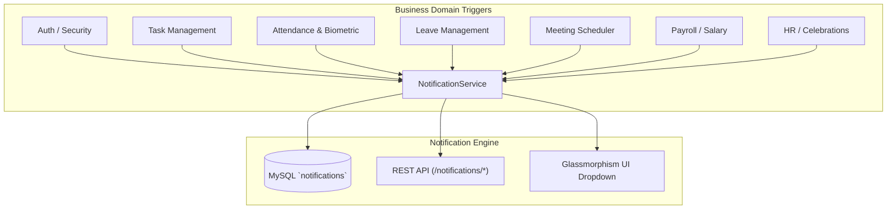

# SmartOffice – Office Automation & Workforce Management System
## Notification Module — System Architecture & Technical Specification

**Document Version:** 1.0  
**Status:** Approved & Implemented  
**Author:** SmartOffice Engineering & Development Team  

---

## 1. Executive Summary & Introduction
The **Notification Module** delivers real-time system updates, critical alerts, scheduled reminders, and administrative broadcasts across the **SmartOffice** platform. It bridges users (Employees, Managers, HR, Accountants, Team Leads, and Administrators) with actionable intelligence and automated workflows, eliminating communication latency and manual follow-ups.

---

## 2. Core Objectives
- **Automated Event-Driven Alerts:** Real-time generation of alerts triggered by business activities (task assignment, leave approvals, meeting invites, security events).
- **Multi-Channel Orchestration:** Unified delivery engine supporting in-app popovers, glassmorphism badge alerts, email (SMTP/HTML cards), and SMS.
- **Auditability & History:** Complete lifecycle tracking (`Unread` → `Read` → `Archived`), timestamps, priority metrics, and audit logs.
- **Filtering & Search:** Full-text keyword search and multi-dimensional filtering by Category, Priority, and Status.

---

## 3. Module Scope & Integration Matrix



---

## 4. Role-Based Access & Delivery Matrix

| Role | Targeted Alerts & Scope |
| :--- | :--- |
| **Admin** | System health, organization broadcasts, audit trail, server maintenance, critical security warnings. |
| **HR** | Leave applications, employee onboarding/profile updates, holiday announcements, birthdays, work anniversaries, document uploads. |
| **Manager** | Task completion updates, team leave requests, scheduled meetings, deadline alerts, performance reviews. |
| **Employee** | Personal task assignments, meeting invitations & reminders, leave status approvals/rejections, attendance & checkout reminders. |
| **Accountant** | Payroll processing events, salary slip releases. |

---

## 5. Notification Taxonomies

### 5.1 Categories (12 Distinct Categories)
1. `Task` — Assignment, progress updates, completion alerts
2. `Leave` — Application submission, approval, rejection
3. `Meeting` — Scheduled meetings, invitations, room allocations
4. `Attendance` — Morning check-in reminders, daily checkout, break duration alerts
5. `Payroll` — Salary disbursement, payslip availability
6. `Announcement` — Organization-wide memos, executive directives
7. `Project` — Milestone tracking, project deadlines
8. `Reminder` — Time-sensitive event reminders (e.g. 30-min meeting alert)
9. `Holiday` — Official holiday broadcasts
10. `Security` — New device login alerts, password modification warnings
11. `Documents` — Official policy releases, document upload confirmations
12. `Performance` — Performance review schedules, milestone appraisals

### 5.2 Priority Matrix
- `Low` — Informational updates (Birthdays, Holiday greetings)
- `Medium` — Standard operational events (Leave submitted, announcement)
- `High` — Action-required events (Task assigned, Meeting invite, Review scheduled)
- `Critical` — Immediate security/system events (Login from new IP, Password changed, Server alert)

### 5.3 Status Lifecycle
- `Unread` ➔ `Read` ➔ `Archived` / `Deleted`

---

## 6. Supported Notification Scenarios (10.1 – 10.18)

| Scenario ID | Name | Trigger Event | Primary Recipient | Default Priority |
| :---: | :--- | :--- | :--- | :--- |
| **10.1** | Task Assignment | Manager assigns task | Assigned Employee | `High` |
| **10.2** | Leave Application | Employee submits leave | Manager / HR | `Medium` |
| **10.3** | Leave Approval/Rejection | Manager acts on leave | Applicant Employee | `High` / `Medium` |
| **10.4** | Meeting Scheduled | Manager creates meeting | All Participants | `High` |
| **10.5** | Meeting Reminder | 30 mins before meeting | All Participants | `High` |
| **10.6** | Attendance Reminder | Unmarked check-in | Active Employees | `High` |
| **10.7** | Checkout Reminder | Unmarked checkout | Active Employees | `Medium` |
| **10.8** | Break Reminder | Break > 30 minutes | Employee | `High` |
| **10.9** | Project Deadline | 24 hrs to deadline | Assignee / Lead | `High` |
| **10.10** | Payroll Slip | Salary generated | Individual Employee | `Medium` |
| **10.11** | Holiday Notice | HR posts holiday | All Staff | `Low` |
| **10.12** | Company Announcement | Admin broadcast | All Staff | `Medium` |
| **10.13** | Password Changed | Password reset/update | Account Owner | `Critical` |
| **10.14** | Login Alert | Login from new device | Account Owner | `Critical` |
| **10.15** | Birthday Alert | Employee birthday | All Staff | `Low` |
| **10.16** | Work Anniversary | Milestone completed | Employee & HR | `Medium` |
| **10.17** | Document Upload | File added to profile | Employee | `Medium` |
| **10.18** | Performance Review | Review scheduled | Employee | `High` |

---

## 7. Database Schema

```sql
CREATE TABLE IF NOT EXISTS notifications (
    notification_id BIGINT PRIMARY KEY AUTO_INCREMENT,
    sender_id BIGINT DEFAULT NULL,
    receiver_id BIGINT DEFAULT NULL,
    title VARCHAR(100) NOT NULL,
    message TEXT NOT NULL,
    category VARCHAR(50) DEFAULT 'Announcement',
    priority VARCHAR(20) DEFAULT 'Medium',
    status VARCHAR(20) DEFAULT 'Unread',
    created_at TIMESTAMP DEFAULT CURRENT_TIMESTAMP,
    read_at TIMESTAMP NULL
);
```

---

## 8. RESTful API Specification

| Method | Endpoint | Description | Request / Response |
| :--- | :--- | :--- | :--- |
| `GET` | `/notifications` | List user's notifications (supports `?category=`, `?priority=`, `?status=`, `?q=`) | `200 OK` JSON Array of `Notification` |
| `GET` | `/notifications/unread` | List only unread notifications | `200 OK` JSON Array |
| `GET` | `/notifications/count` | Get real-time unread count for badge polling | `200 OK` `{"unreadCount": 3}` |
| `POST` | `/notifications` | Create and dispatch notification | `201 Created` `{"success": true, "notificationId": 12}` |
| `PUT` | `/notifications/read/{id}` | Mark a single notification as read | `200 OK` `{"success": true, "id": 12}` |
| `PUT` | `/notifications/archive/{id}` | Archive a notification | `200 OK` `{"success": true, "id": 12}` |
| `DELETE` | `/notifications/{id}` | Permanently remove notification | `200 OK` `{"success": true, "id": 12}` |
| `DELETE` | `/notifications/all` | Purge/clear all user notifications | `200 OK` `{"success": true}` |

---

## 9. Key Source Implementation Files

- **Model:** [`Notification.java`](file:///c:/Users/rajes/eclipse-workspace/Employee_Leave_And_Attendance_Management/src/main/java/com/rajesh/elams/model/Notification.java)
- **DAO:** [`NotificationDao.java`](file:///c:/Users/rajes/eclipse-workspace/Employee_Leave_And_Attendance_Management/src/main/java/com/rajesh/elams/dao/NotificationDao.java) & [`NotificationDaoImpl.java`](file:///c:/Users/rajes/eclipse-workspace/Employee_Leave_And_Attendance_Management/src/main/java/com/rajesh/elams/dao/NotificationDaoImpl.java)
- **Service Layer:** [`NotificationService.java`](file:///c:/Users/rajes/eclipse-workspace/Employee_Leave_And_Attendance_Management/src/main/java/com/rajesh/elams/service/NotificationService.java)
- **REST Endpoints:** [`NotificationApiServlet.java`](file:///c:/Users/rajes/eclipse-workspace/Employee_Leave_And_Attendance_Management/src/main/java/com/rajesh/elams/servlet/NotificationApiServlet.java) & [`NotificationServlet.java`](file:///c:/Users/rajes/eclipse-workspace/Employee_Leave_And_Attendance_Management/src/main/java/com/rajesh/elams/servlet/NotificationServlet.java)
- **UI Components:** [`notificationBar.jspf`](file:///c:/Users/rajes/eclipse-workspace/Employee_Leave_And_Attendance_Management/src/main/webapp/WEB-INF/jspf/notificationBar.jspf), [`notificationDropdown.jsp`](file:///c:/Users/rajes/eclipse-workspace/Employee_Leave_And_Attendance_Management/src/main/webapp/includes/notificationDropdown.jsp), and [`sendNotification.jsp`](file:///c:/Users/rajes/eclipse-workspace/Employee_Leave_And_Attendance_Management/src/main/webapp/sendNotification.jsp)
