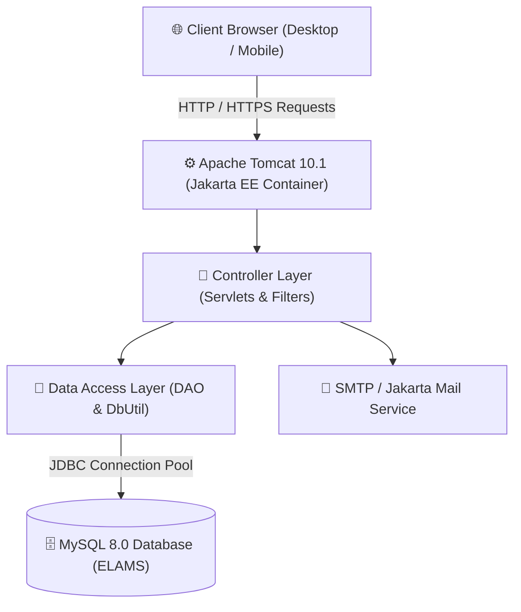
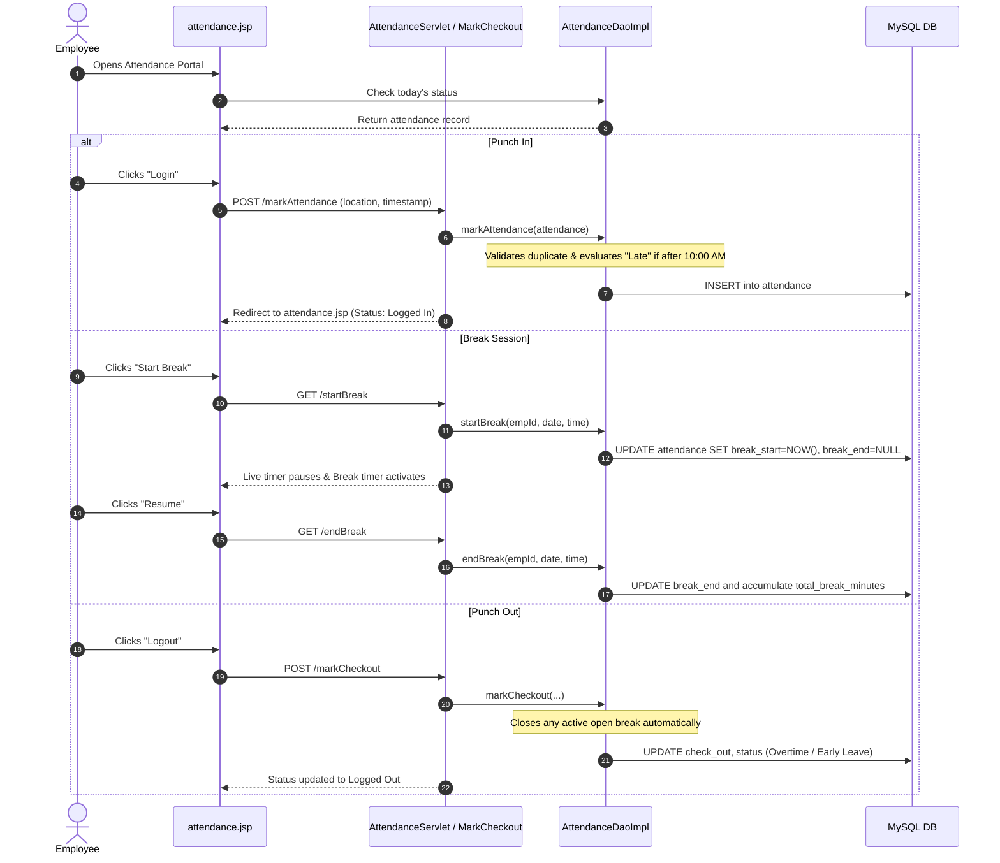
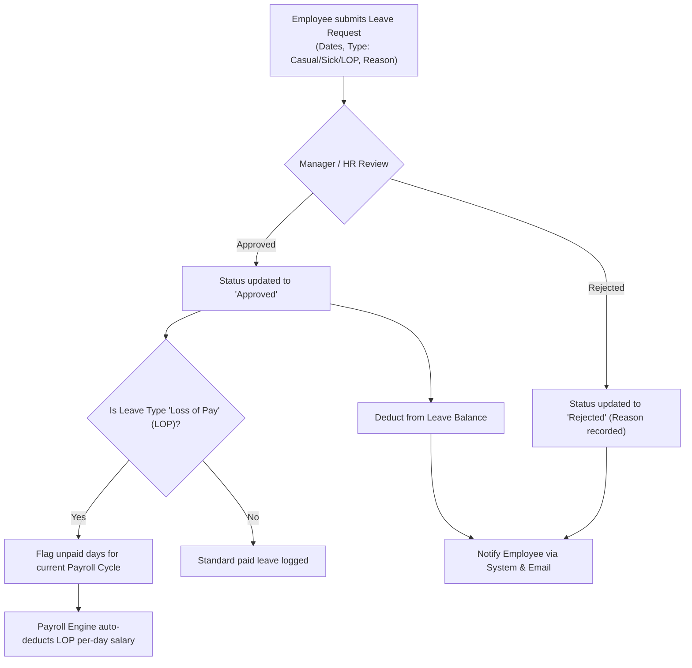
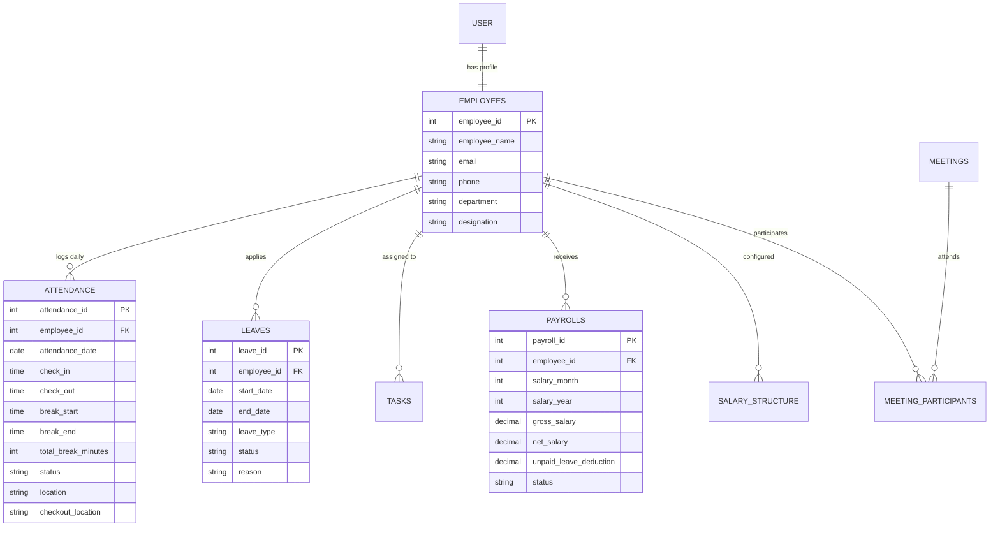

# 🏢 Employee Leave & Attendance Management System (ELAMS)
> **Comprehensive System Documentation, Architecture & Operational Workflows**  
> *Ready to import or paste directly into your Notion workspace.*

---

## 📌 Executive Summary
**ELAMS (Employee Leave & Attendance Management System)** is an enterprise-grade web application built to streamline human resource operations, attendance tracking, multi-tier leave approval workflows, automated payroll computations, task allocations, and corporate meeting management.

### Key Highlights
* **Zero Overhead Stack**: Jakarta EE 10 (Servlet 6.0 / JSP), Apache Tomcat 10.1, MySQL 8.0+.
* **Security & Compliance**: BCrypt cryptographic hashing, session-based RBAC, real-time login audit trails, and enterprise IP/geo-logging.
* **Integrated Business Logic**: Attendance & unpaid leave (LOP) directly link into automated payroll calculations.

---

## 🏗️ Architecture & Technology Stack



| Layer | Technologies & Libraries |
| :--- | :--- |
| **Presentation Layer** | JSP 3.1, JSTL, HTML5, CSS3 Glassmorphism, FontAwesome 6.6, Vanilla JavaScript (Real-time timers) |
| **Controller Layer** | Jakarta EE 10 (`jakarta.servlet.http.HttpServlet`, `@WebServlet`), Dynamic Session Management |
| **Service & Business Layer** | `NotificationService`, `AuditService`, `PayrollCalculationService` |
| **Persistence Layer** | DAO Pattern (`*Dao` interfaces & `*DaoImpl` JDBC implementations), `DbUtil` connection management |
| **Database** | MySQL 8.0+ (InnoDB Engine, Foreign Key cascading, transaction integrity) |
| **Security & Utilities** | `jBCrypt-0.4` password hashing, `angus-mail-2.1.0` email dispatcher |

---

## 👥 Role-Based Access Control (RBAC) Matrix

| Feature / Module | Admin | HR Manager | Team Manager | Employee |
| :--- | :---: | :---: | :---: | :---: |
| **Punch In / Out & Break Tracking** | ✅ | ✅ | ✅ | ✅ |
| **View Personal Attendance History** | ✅ | ✅ | ✅ | ✅ |
| **View All Employees Attendance** | ✅ | ✅ | ✅ (Team) | ❌ |
| **Apply for Leave** | ✅ | ✅ | ✅ | ✅ |
| **Approve / Reject Leave Applications** | ✅ | ✅ | ✅ | ❌ |
| **Employee Directory (Create / Edit)** | ✅ | ✅ | ❌ | ❌ |
| **Task Assignment & Tracking** | ✅ | ❌ | ✅ | ✅ (View/Update) |
| **Schedule Meetings & Reserve Rooms** | ✅ | ✅ | ✅ | ❌ |
| **Generate & Process Payroll (with LOP)** | ✅ | ✅ | ❌ | ❌ |
| **View Personal Payslips** | ✅ | ✅ | ✅ | ✅ |
| **Audit Logs & System Settings** | ✅ | ❌ | ❌ | ❌ |

---

## 🔄 End-to-End System Workflows

### 1. Attendance & Duty Session Workflow


---

### 2. Leave Request & Approval Lifecycle


---

### 3. Payroll Calculation & Deduction Flow
* **Gross Salary Formula**:
  $$\text{Gross Salary} = \text{Basic} + \text{HRA} + \text{Transport} + \text{Medical} + \text{Other Allowances}$$
* **Loss of Pay (LOP) Deduction**:
  $$\text{Per Day Salary} = \frac{\text{Gross Salary}}{\text{Working Days in Month (e.g. 26)}}$$
  $$\text{LOP Deduction} = \text{Per Day Salary} \times \text{Approved Unpaid Leave Days}$$
* **Statutory Deductions**:
  $$\text{Total Deductions} = \text{PF} + \text{Professional Tax} + \text{LOP Deduction} + \text{Loan Deductions}$$
* **Net Salary Paid**:
  $$\text{Net Salary} = \text{Gross Salary} - \text{Total Deductions}$$

---

## 🗄️ Database Schema Overview (Core Tables)



---

## 🚀 Deployment & Local Execution Guide

### Prerequisites
* Java JDK 17+ (or JDK 21 / 26)
* Apache Tomcat 10.1+
* MySQL Server 8.0+

### Step-by-Step Setup
1. **Database Setup**:
   ```sql
   CREATE DATABASE ELAMS;
   USE ELAMS;
   SOURCE schema.sql;
   ```
2. **Database Credentials**:
   Verify `src/main/java/com/rajesh/elams/util/DbUtil.java`:
   ```java
   url = "jdbc:mysql://localhost:3306/ELAMS";
   user = "root";
   pwd  = "root"; // your mysql password
   ```
3. **Run via Eclipse / IDE**:
   * Right-click `Employee_Leave_And_Attendance_Management` → **Run As** → **Run on Server** (Apache Tomcat v10.1).
   * URL: `http://localhost:8080/Employee_Leave_And_Attendance_Management/login.jsp`

---

## 📋 Recommended Notion Structure
When importing this document into Notion:
1. **Create a Top-Level Page**: `ELAMS - Engineering & Product Wiki`.
2. **Sub-Pages**:
   * 📊 **Dashboard & Metrics Tracker**
   * ⏱️ **Attendance & Break Engine Spec**
   * 🌴 **Leave & LOP Policy Guide**
   * 💰 **Payroll Math & Statutory Formulas**
   * 🗃️ **Database Dictionary (DDL & ERD)**
