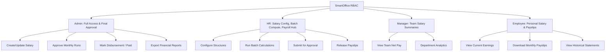
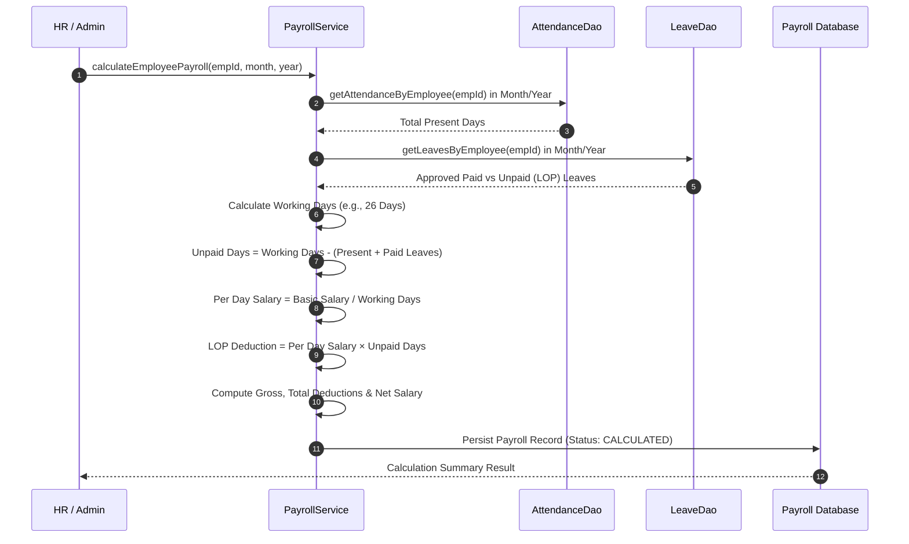
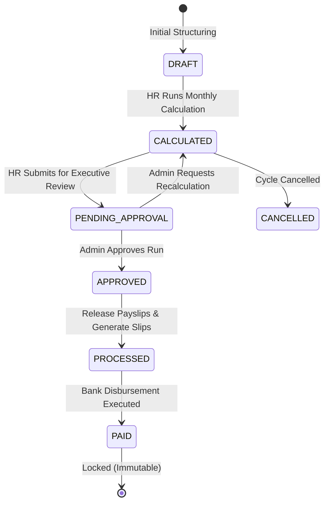

# SmartOffice – Office Automation & Workforce Management System
## Module 11: Payroll & HR Management — Technical Architecture & Specification

**Module Name:** Module 11 — Payroll & Basic HR Management  
**Document Version:** 1.0  
**Status:** Implemented & Production-Ready  
**Author:** SmartOffice Engineering & Architecture Team  

---

## 1. Executive Summary & Module Overview
The **Payroll & HR Management Module** (Module 11) manages employee compensation, dynamic salary structures, attendance/leave-integrated monthly payroll computation, multi-stage approval lifecycles, and cryptographic payslip distribution.

Designed as an achievable, robust enterprise payroll engine using Java Servlets, JSP, JDBC, and MySQL, the module provides:
- Granular salary component configuration (Earnings vs Deductions).
- Dynamic per-day Loss of Pay (LOP) deductions driven by live Attendance and Leave modules.
- Enterprise Multi-Stage Workflow: `DRAFT` &rarr; `CALCULATED` &rarr; `PENDING_APPROVAL` &rarr; `APPROVED` &rarr; `PROCESSED` &rarr; `PAID`.
- Role-based visibility and access control (Admin, HR, Manager, Employee).
- Comprehensive PDF/Print-ready payslips and historical compensation records.

---

## 2. Core Objectives
- **Maintain Salary Profiles:** Separate mutable salary structures from immutable employee profiles.
- **Componentized Compensation:** Modular breakdown of earnings and statutory/voluntary deductions.
- **Biometric & Leave Integrated Computation:** Automatic calculation of present days, paid leaves, and unpaid days to compute exact LOP deductions.
- **Automated Batch Processing:** 1-click batch calculation for all active employees.
- **Multi-Stage Approval Workflow:** HR calculates and submits for executive Admin approval before disbursement.
- **Digital Payslip Portal:** Employee self-service payslip viewer with historical archiving and printable layouts.
- **Financial Analytics & Reporting:** Monthly department-wise totals, deduction breakdowns, and bank disbursement exports.

---

## 3. Role-Based Access Control (RBAC) Matrix

| Role | Permissions & Operational Scope | Primary Endpoints |
| :--- | :--- | :--- |
| **Admin** | Full access: Configure salary structures, calculate payroll, approve submitted runs, mark disbursement (`PAID`), view audit logs, export financial reports. | `/payrollDashboard`, `/manageSalary`, `/payrollReport`, `/processPayroll` |
| **HR** | Full operational management: Configure salary structures, run batch monthly calculations, review breakdown, submit for approval, release payslips. | `/hrDashboard`, `/payrollDashboard`, `/manageSalary`, `/payrollReport` |
| **Manager** | View-only access to direct team member compensation summaries and department totals (no editing or processing permissions). | `/teamPayroll`, `/managerDashboard` |
| **Employee** | Self-service access: View current month salary breakdown, download official payslips, and browse personal historical payroll records. | `/myPayroll`, `/payslip` |

---

## 4. Salary Component Architecture

Salary is never stored as a flat scalar number. It is decomposed into structured components:

$$\text{Gross Salary} = \text{Basic} + \text{HRA} + \text{Transport} + \text{Medical} + \text{Bonus} + \text{Other Allowances}$$

$$\text{Total Deductions} = \text{PF} + \text{Professional Tax} + \text{Loan} + \text{Advance} + \text{LOP Deduction} + \text{Other}$$

$$\text{Net Salary} = \max(0, \text{Gross Salary} - \text{Total Deductions})$$

### 4.1 Earnings Breakdown
| Component | Classification | Description / Standard Formula |
| :--- | :--- | :--- |
| **Basic Salary** | Fixed Base | Foundation of total compensation; basis for per-day LOP and PF calculation. |
| **HRA (House Rent Allowance)** | Fixed Allowance | Standard housing assistance (e.g., 30–40% of Basic). |
| **Transport Allowance** | Fixed Allowance | Commuting and conveyance allowance. |
| **Medical Allowance** | Fixed Allowance | Healthcare support reimbursement. |
| **Performance Bonus** | Variable Earning | Month-specific discretionary bonus or project incentive. |
| **Other Allowances** | Variable Earning | Special allowances or non-standard benefits. |

### 4.2 Deductions Breakdown
| Component | Classification | Description / Standard Formula |
| :--- | :--- | :--- |
| **PF (Provident Fund)** | Statutory Deduction | Retirement contribution (e.g., standard 12% of Basic or flat amount). |
| **Professional Tax (PT)** | Statutory Deduction | State-mandated professional tax (e.g., flat ₹200). |
| **Loan Deduction** | Voluntary Deduction | Monthly recovery against company advance/loan. |
| **Advance Salary** | Variable Deduction | Recovery for mid-month salary advances taken. |
| **Unpaid Leave (LOP)** | Dynamic Deduction | Computed dynamically from attendance and unexcused leaves. |
| **Other Deductions** | Voluntary Deduction | Miscellaneous insurance or welfare contributions. |

---

## 5. Attendance & Leave Integration (Dynamic LOP Engine)

The payroll engine integrates directly with **Module 4 (Attendance)** and **Module 5 (Leave Management)**:

### Mathematical Example:
- **Employee:** EMP102 (Rahul Kumar) &bull; **Month:** August 2026
- **Basic Salary:** ₹30,000 &bull; **HRA:** ₹10,000 &bull; **Transport:** ₹3,000 &bull; **Medical:** ₹2,000
- **Gross Salary:** ₹45,000
- **Standard Working Days:** 26 &bull; **Present Days:** 24 &bull; **Unpaid Days (LOP):** 2

$$\text{Per Day Salary} = \frac{₹30,000}{26} = ₹1,153.85$$

$$\text{LOP Deduction} = ₹1,153.85 \times 2 = ₹2,307.70$$

$$\text{Total Deductions} = \text{PF}(₹3,600) + \text{PT}(₹200) + \text{Other}(₹500) + \text{LOP}(₹2,307.70) = ₹6,607.70$$

$$\text{Net Salary} = ₹45,000 - ₹6,607.70 = ₹38,392.30$$

---

## 6. Payroll Status & Enterprise Approval Lifecycle

| Status | Code State | Allowed Actions | Description |
| :--- | :--- | :--- | :--- |
| `DRAFT` | `DRAFT` | Edit Structure, Recalculate | Initial template configuration. |
| `CALCULATED` | `CALCULATED` | Adjust Bonus/Advance, Submit | Month-specific numbers computed. |
| `PENDING_APPROVAL` | `PENDING_APPROVAL` | Approve, Reject, Review | Awaiting executive Admin review. |
| `APPROVED` | `APPROVED` | Process Run, Unlock Payslips | Formally approved by leadership. |
| `PROCESSED` | `PROCESSED` | Generate PDF, View Payslip, Mark Paid | Payslips published to employee portals. |
| `PAID` | `PAID` | View Payslip, Export Statement | Money disbursed; record permanently locked. |
| `CANCELLED` | `CANCELLED` | Archive | Voided payroll run. |

---

## 7. Database Schema & Data Dictionary

### Table 1: `salary_structures`
| Column Name | Data Type | Constraints | Description |
| :--- | :--- | :--- | :--- |
| `structure_id` | `INT` | `PRIMARY KEY`, `AUTO_INCREMENT` | Unique salary structure record ID. |
| `employee_id` | `INT` | `NOT NULL`, `FK -> employees` | Employee mapping reference. |
| `basic_salary` | `DECIMAL(10,2)` | `NOT NULL` | Base monthly salary. |
| `hra` | `DECIMAL(10,2)` | `DEFAULT 0.00` | House Rent Allowance. |
| `transport_allowance`| `DECIMAL(10,2)` | `DEFAULT 0.00` | Commuting allowance. |
| `medical_allowance` | `DECIMAL(10,2)` | `DEFAULT 0.00` | Medical allowance. |
| `other_allowances` | `DECIMAL(10,2)` | `DEFAULT 0.00` | Miscellaneous earnings. |
| `pf` | `DECIMAL(10,2)` | `DEFAULT 0.00` | Provident Fund deduction. |
| `professional_tax` | `DECIMAL(10,2)` | `DEFAULT 0.00` | State tax deduction. |
| `loan_deduction` | `DECIMAL(10,2)` | `DEFAULT 0.00` | Recurring loan recovery. |
| `other_deductions` | `DECIMAL(10,2)` | `DEFAULT 0.00` | Voluntary deductions. |
| `effective_from` | `DATE` | `NOT NULL` | Effective start date of structure. |
| `status` | `VARCHAR(20)` | `DEFAULT 'ACTIVE'` | `ACTIVE`, `INACTIVE`. |

### Table 2: `payroll`
| Column Name | Data Type | Constraints | Description |
| :--- | :--- | :--- | :--- |
| `payroll_id` | `INT` | `PRIMARY KEY`, `AUTO_INCREMENT` | Unique monthly payroll transaction ID. |
| `employee_id` | `INT` | `NOT NULL`, `FK -> employees` | Target employee reference. |
| `payroll_month` | `INT` | `NOT NULL` | Month of pay (1–12). |
| `payroll_year` | `INT` | `NOT NULL` | Year of pay (e.g., 2026). |
| `basic_salary` | `DECIMAL(10,2)` | `NOT NULL` | Snapshotted basic salary. |
| `hra` | `DECIMAL(10,2)` | `DEFAULT 0.00` | Snapshotted HRA. |
| `transport_allowance`| `DECIMAL(10,2)`| `DEFAULT 0.00` | Snapshotted transport. |
| `medical_allowance` | `DECIMAL(10,2)` | `DEFAULT 0.00` | Snapshotted medical. |
| `bonus` | `DECIMAL(10,2)` | `DEFAULT 0.00` | Performance/festival bonus for the month. |
| `other_allowances` | `DECIMAL(10,2)` | `DEFAULT 0.00` | Other earnings. |
| `gross_salary` | `DECIMAL(10,2)` | `NOT NULL` | Total earnings before deductions. |
| `pf` | `DECIMAL(10,2)` | `DEFAULT 0.00` | PF deduction. |
| `professional_tax` | `DECIMAL(10,2)` | `DEFAULT 0.00` | Professional tax. |
| `loan_deduction` | `DECIMAL(10,2)` | `DEFAULT 0.00` | Loan repayment deduction. |
| `advance_salary` | `DECIMAL(10,2)` | `DEFAULT 0.00` | Mid-month advance recovery. |
| `unpaid_leaves` | `INT` | `DEFAULT 0` | Total LOP days. |
| `lop_deduction` | `DECIMAL(10,2)` | `DEFAULT 0.00` | Calculated LOP deduction amount. |
| `other_deductions` | `DECIMAL(10,2)` | `DEFAULT 0.00` | Other deductions. |
| `total_deductions` | `DECIMAL(10,2)` | `NOT NULL` | Sum of all deductions. |
| `net_salary` | `DECIMAL(10,2)` | `NOT NULL` | Final disbursement amount. |
| `working_days` | `INT` | `DEFAULT 26` | Total days in calculation period. |
| `present_days` | `INT` | `DEFAULT 0` | Attended days. |
| `paid_leaves` | `INT` | `DEFAULT 0` | Approved paid leaves. |
| `payment_method` | `VARCHAR(50)` | `DEFAULT 'Bank Transfer'`| `Bank Transfer`, `Cheque`, `UPI`. |
| `payment_date` | `DATE` | `NULL` | Actual date salary credited. |
| `status` | `VARCHAR(30)` | `DEFAULT 'CALCULATED'`| `CALCULATED`, `PENDING_APPROVAL`, `APPROVED`, `PROCESSED`, `PAID`. |
| `processed_by` | `INT` | `NULL`, `FK -> users` | Actor who executed calculation/processing. |
| `created_at` | `TIMESTAMP` | `DEFAULT CURRENT_TIMESTAMP`| Audit creation timestamp. |

---

## 8. Screen & Endpoint Specification

### 8.1 HR / Admin Payroll Dashboard (`/payrollDashboard`, `payrollDashboard.jsp`)
- **Top Metrics:** Total Active Employees, Total Monthly Payroll Budget, Total Processed Slips, Pending Action Count.
- **Filter Controls:** Month selector, Year selector, Department filter, Status filter.
- **Operational Controls:**
  - 1-Click *Calculate All Active Employees* (Batch run).
  - *Submit Payroll for Approval* (HR &rarr; Admin).
  - *Approve Monthly Payroll* (Admin exclusive).
  - *Process & Release Payslips* (Publishes to employee portals).
  - *Mark as Disbursed (PAID)* (Locks records).
- **Interactive Breakdown Table:** Employee ID, Name, Department, Gross, Total Deductions, Net Pay, Status badge, Quick Actions (View Payslip, Edit Bonus).

### 8.2 Salary Structure Management (`/manageSalary`, `manageSalary.jsp`)
- Configure and update base salary, standard allowances, and recurring deductions per employee.
- Automatically creates default baseline structure if not yet configured.

### 8.3 Employee Self-Service Portal (`/myPayroll`, `myPayroll.jsp`)
- Current month compensation summary card.
- Live status indicator (`CALCULATED`, `APPROVED`, `PAID`).
- 1-Click *View & Download Payslip*.
- Multi-year chronological Payroll History ledger.

### 8.4 Team Payroll Overview (`/teamPayroll`, `teamPayroll.jsp`)
- Designed specifically for Department Managers.
- Displays team member names, designation, gross, deductions, and net pay without giving access to recalculate or modify structures.

### 8.5 Digital Payslip Viewer (`/payslip`, `payslip.jsp`)
- Standard corporate pay-slip layout with ELAMS watermark and company branding.
- Dual columns: **Earnings** vs **Deductions**.
- Metadata: Pay Period, Employee ID, Name, Department, Designation, Payment Mode, Disbursement Date.
- Native browser print styling (`window.print()`) for 1-click PDF download.

---

## 9. Architectural Validation & Robustness
1. **Historical Immutability:** Old payroll records snapshot the active salary structure and attendance numbers at calculation time. Even if an employee's salary changes later, past payslips remain exact and tamper-proof.
2. **Negative Salary Protection:** Net salary is guaranteed non-negative ($\ge ₹0.00$) via Math ceiling guards.
3. **Double-Calculation Safeguard:** Batch calculations automatically bypass already paid/disbursed records to prevent inadvertent overwrite.
4. **Role Isolation:** Employees can never access management recalculation servlets; managers can only view aggregated team figures; only Admins can execute final approval and disbursement locking.
